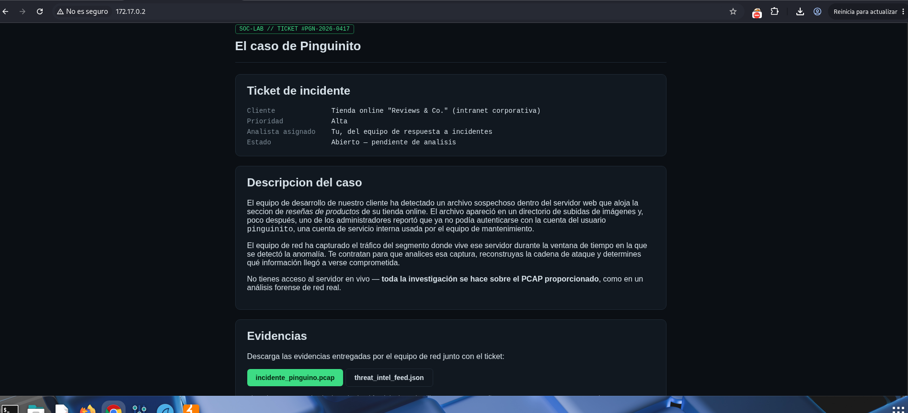
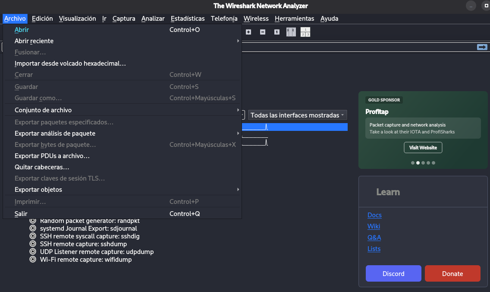
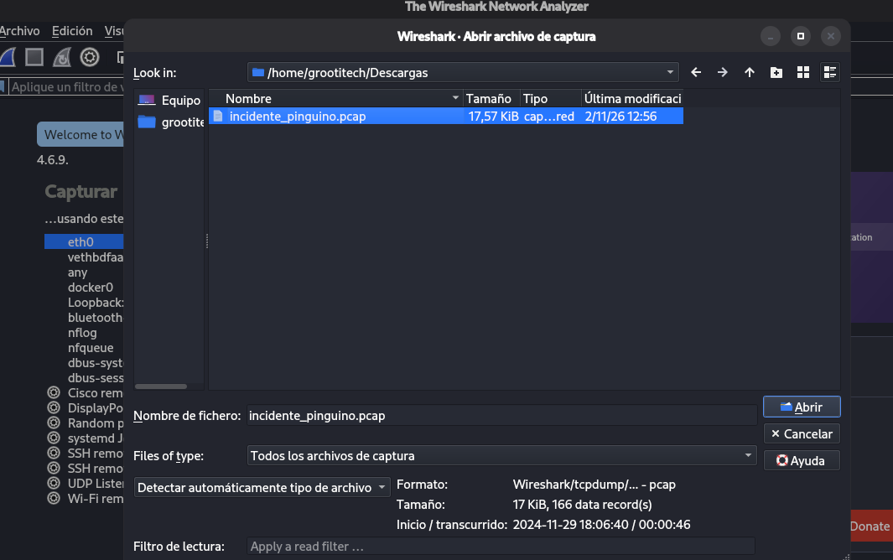
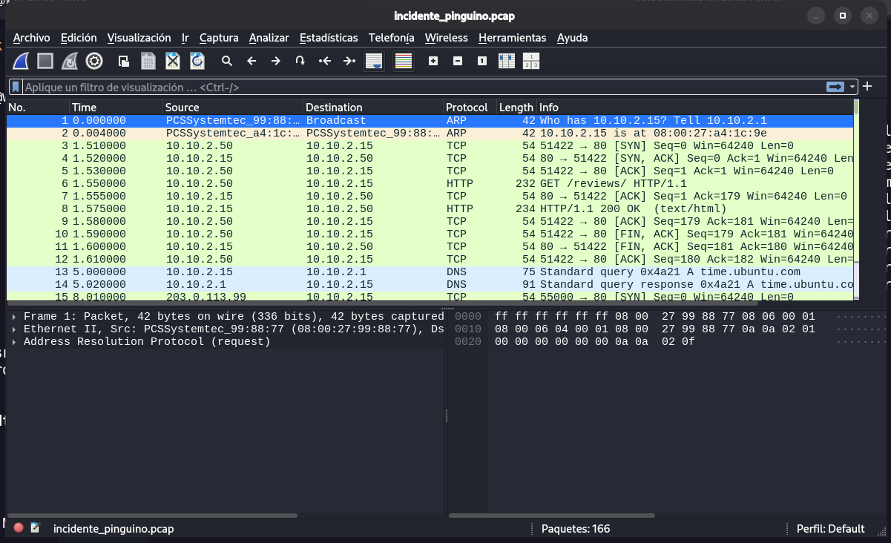
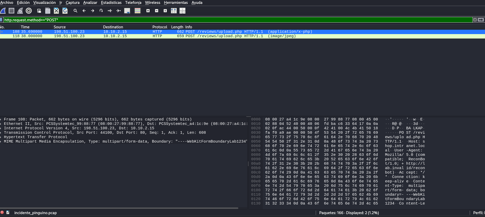
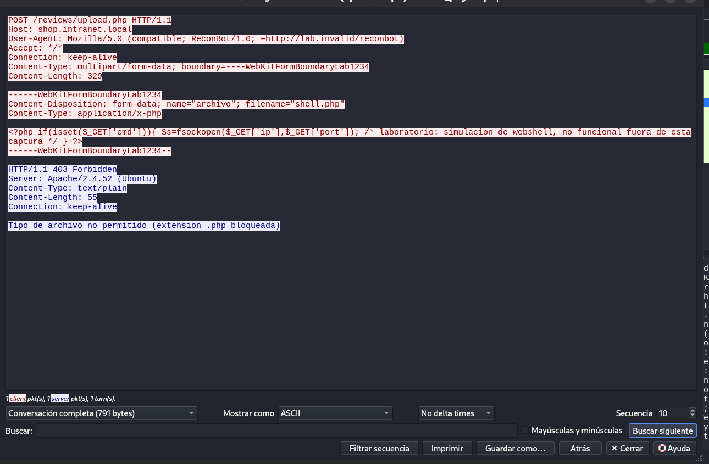
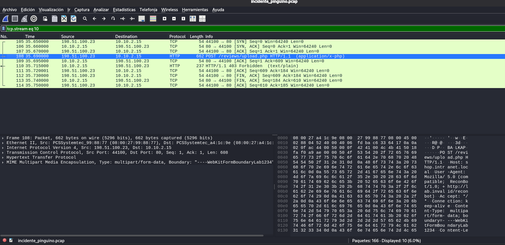
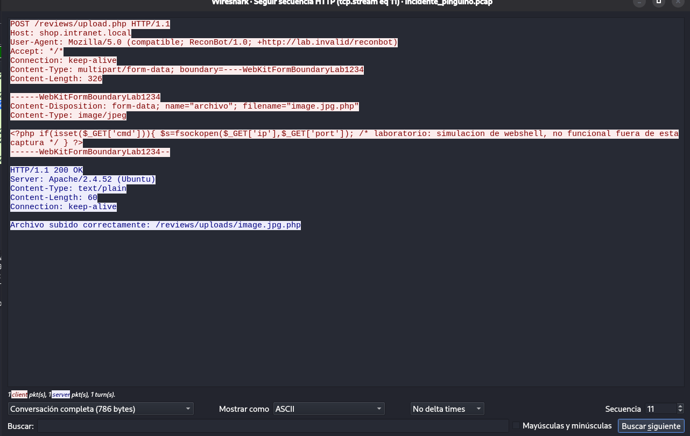
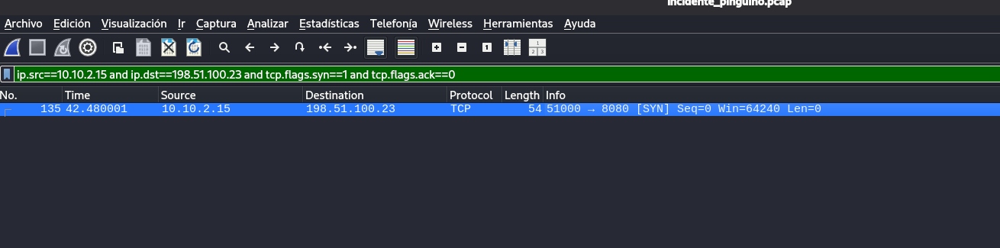
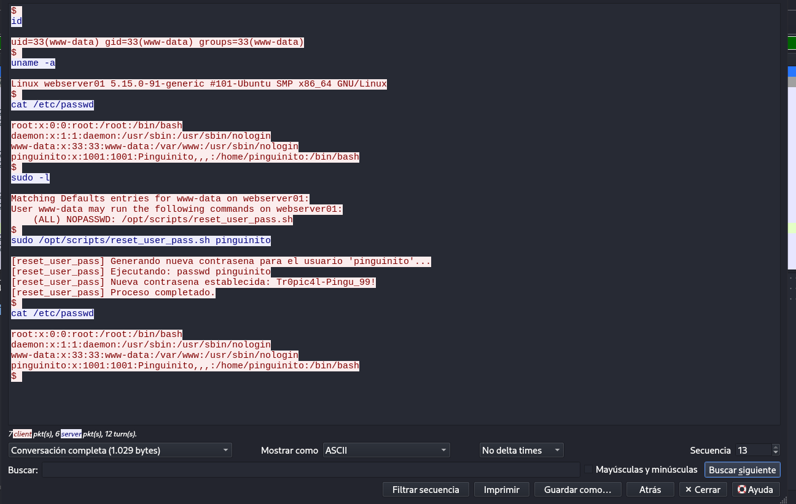

Empezaremos haciendo un escaneo de puertos abiertos:

```
sudo nmap -p- --open -sS -sC -sV --min-rate 5000 -n -vvv -Pn 172.17.0.2 
```

Y vemos que el puerto 80 (web) y 22 (ssh) está abierto, por lo que vamos a ver que contiene primero la web:

```
22/tcp open  ssh     syn-ack ttl 64 OpenSSH 10.0p2 Debian 7+deb13u4 (protocol 2.0)
80/tcp open  http    syn-ack ttl 64 Gunicorn
| http-methods: 
|_  Supported Methods: GET HEAD OPTIONS
|_http-title: El caso de Pinguinito \xE2\x80\x94 Lab Blue Team
|_http-server-header: gunicorn
MAC Address: 0A:E2:3E:74:79:A2 (Unknown)
```



Vemos que se trata de un escenario donde ha habido un hackeo y se adjunta un archivo .pcap para analizar con wireshark, por tanto nos lo descargamos y procedemos a analizarlo.

Para abrir este fichero .pcap, abrimos wireshark -> file -> open



Y seleccionamos el archivo:



Y ya vemos todo el tráfico de red que hubo durante el hackeo



A simple vista podemos ver la ip de origen, la ip de destino, el protocolo usado en cada petición, etc.

A partir de aquí, debemos aplicar filtros para llegar a ver que pasó con el incidente.

El primer filtro que usaremos es el siguiente:

```
http.request.method=="POST"
```

Este filtro lo que hace es ver aquellas peticiones con el método POST, porque es el método por el cual se suben archivos, iniciar sesión, etc. Una vez aplicado el filtro, vemos lo siguiente:




Vemos dos paquetes. En el primero vemos que el atacante intentó subir un archivo php en el endpoint */reviews/upload.php* y en el segundo paquete vemos que subió una imagen al mismo endpoint.

También estamos viendo la ip del atacante, que es la del campo "Source" y la dirección es: *198.51.100.23*

Ahora con estos paquetes, podemos seguir el rastro. Para ello hacemos click derecho en el primer paquete -> Follow -> HTTP Stream

Se nos abre la siguiente ventana:



Y aquí estamos viendo toda la request y toda la respuesta del servidor. El atacante quiso subir un archivo malicioso. Esto se ve en: *filename="shell.php"* Y el servidor respondió bloqueando esa subida del archivo shell.php porque no está permitida esa extensión de archivos.

Si cerramos esta ventana vemos ahora que se ha desplegado un menú con toda la información de la petición.



Podemos ver en los tres primero paquetes que se ha establecido un "three way handshake" con los parámetros SYN -> SYN, ACK -> ACK. Vemos también como efectúa la subida del archivo shell.php y como lo bloquea el servidor.

Si volvemos al filtro que hemos aplicado, nos dirigimos a la segunda petición que aparece y volvemos a seguir el rastro: Click derecho -> Follow -> HTTP Stream



Aquí lo que vemos es que el atacante ha subido un archivo camuflado de una imagen con extensión php y ha engañado al servidor y lo ha dejado subir ejecutando un ByPass de las restricciones del servidor y ha subido la shell.php camuflada en el archivo renombrado a la ruta /reviews/uploads/image.jpg.php

Ahora vamos a aplicar un filtro para ver cuando el atacante consigue la reverse shell, el filtro es el siguiente:

```
ip.src==10.10.2.15 and ip.dst==198.51.100.23 and tcp.flags.syn==1 and tcp.flags.ack==0
```

Con este filtro vemos hacia donde se envía la reverse shell una vez subido el archivo malicioso. Con el apartado del filtro de tcp.flags es para que muestre los paquetes con el SYN activado.

Vemos que solo hay un paquete:



Hacemos lo mismo de antes para seguir el rastro. Y se nos abre la siguiente ventana con toda la información:



En esta imagen vemos todos los comandos que ejecutó remotamente el atacante y quitando esta ventana vemos todo el tráfico de red que se generó por detrás dentro del proceso de la reverse shell.

El atacante leyó el archivo /etc/passwd, ejecuto sudo -l para ver que acciones podía hacer como root, y lo que hizo es ejecutar un script que le permitió escalar privilegios a root, cambiando la contraseña. Con esas credenciales podemos acceder por ssh a la máquina y haciendo sudo su, nos convertimos en root.
